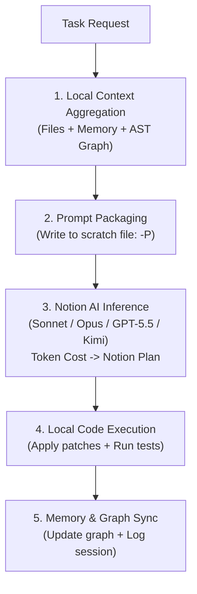

# Notion AI & Antigravity Hybrid Orchestration Skill (`notion-ai`)

Turn Notion AI into a zero-token-cost autonomous reasoning engine and terminal companion for **Antigravity**, **Claude Code**, **Codex**, and **Kimi**.

---

## 🎯 Architecture: The Local + Cloud Synergy

| Capability | Local Agent (Antigravity/Claude Code/Codex) | Notion AI Cloud Engine | **Hybrid Mode** |
|---|---|---|---|
| **Local Files & Git** | ✅ Full OS & terminal access | ❌ Blind to local environment | ✅ **Full access** |
| **Central Memory & Code Graphs** | ✅ NotebookLM, Graphify, SQLite | ❌ No local memory access | ✅ **Memory-informed** |
| **Command & Test Execution** | ✅ Compilers, test runners, linters | ❌ Cannot execute shell commands | ✅ **Automated testing** |
| **LLM Token Costs** | ⚠️ Metered per-token API billing | ✅ Included in Notion AI plan | ✅ **$0 Marginal API Cost** |

> [!IMPORTANT]
> **Orchestration Principle:** The local agent serves as the **Eyes, Hands, and Memory** (file management, terminal commands, context preparation). Notion AI serves as the **Brain** (deep reasoning, code synthesis, $0 token consumption).

---

## 🔄 5-Step Hybrid Execution Protocol



1. **Context Aggregation:** Collect target source files, relevant architecture decisions from memory (`query_notebooklm`, `read_doc`), and dependency relations from code graph (`graphify query`).
2. **Prompt Packaging (`-P`):** Write prompt and context into a temporary file. This bypasses Windows CLI argument length limits (8191 chars) and ensures clean multi-file ingestion.
3. **Notion AI Inference (`notion-ai`):** Dispatch task via CLI (`notion-ai -m sonnet -P <file>`). Selected model synthesizes the patch/solution.
4. **Local Execution:** Parse code blocks, apply atomically to disk (`edit_file` / `write_file`), and run compiler/test suite (`pytest`, `npm test`, `cargo test`).
5. **Memory Synchronization:** Update AST graph (`graphify update .`) and record session details to central memory.

---

## 🔐 Authentication & Session Lifecycle

Before dispatching tasks to Notion AI, ensure the local environment is authenticated:

```powershell
# Check current connection & workspace
voyager-relay whoami

# Automated browser login (Chrome / Edge with CDP)
voyager-relay login

# Manual token paste (masked terminal prompt)
voyager-relay login --manual

# Disconnect & remove local credentials
voyager-relay logout
```

### 🛡️ Agent Security Rules (Mandatory)

1. **Never ask the user to paste `token_v2`, passwords, or cookies into the conversation window.** Always direct the user to run `voyager-relay login` in their local terminal.
2. **Never log, commit, or print credential files** (`accounts.json`, `.env`).
3. If unauthenticated, gracefully catch the error and prompt the user with the command: `voyager-relay login`.
4. Ensure all token data remains strictly local and communicates solely with `https://www.notion.so/api/v3` over HTTPS.

---

## 🛠️ CLI Quick Reference

```powershell
# Default query
notion-ai "Explain async rate limiting"

# Select model: sonnet, opus, gpt, gemini, deepseek, kimi
notion-ai -m sonnet "Optimize this algorithm"
notion-ai -m kimi "Analyze edge cases"

# Feed files & context
notion-ai -f main.py "Find potential race conditions"
notion-ai -P prompt_with_context.txt

# Safe AST code patching with diff review & rollback
notion-ai -e app.py "Add error handling"
notion-ai -e app.py -y "Apply without confirmation prompt"
notion-ai --rollback app.py

# Interactive REPL session
notion-ai

# Direct Notion workspace page export
notion-ai -s "Architecture Decision Record" "Draft ADR for payment service"
```

---

## 🌐 Local OpenAI-Compatible Server (Port 8765)

For tools that connect over standard OpenAI endpoints (Cursor, Cline, Zed, OpenCode):

```powershell
python -m uvicorn app.server:app --app-dir "<path_to_notion2api>" --host 127.0.0.1 --port 8765
```
* **Base URL:** `http://127.0.0.1:8765/v1`
* **Chat Endpoint:** `POST http://127.0.0.1:8765/v1/chat/completions`
* **Models:** `claude-sonnet4.6`, `claude-opus4.6`, `gpt-5.5`, `kimi-2.7`, `gemini-3.5flash`, `deepseek-v4pro`
